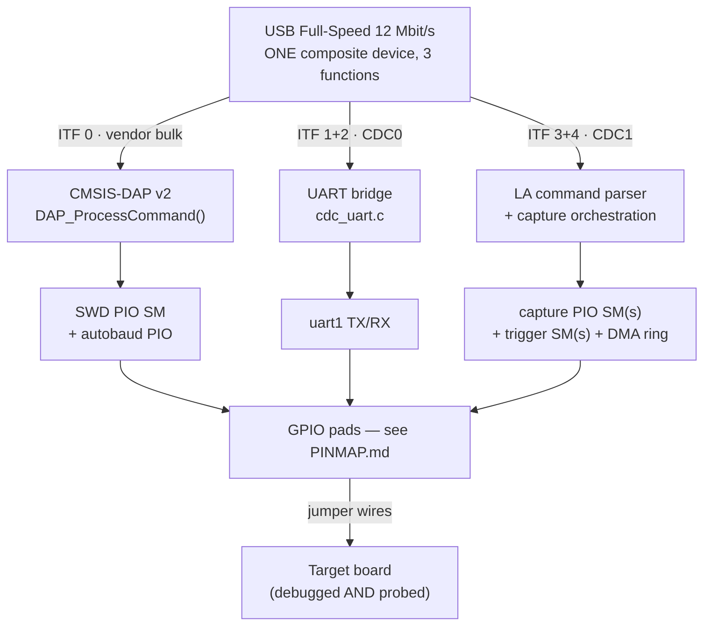
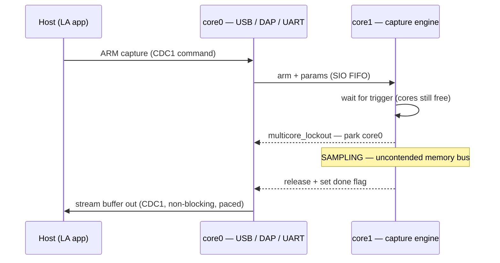

# Deep dive — how the merged probe + logic analyzer actually works

This is the "how it works in depth" companion to ARCHITECTURE.md. It covers the
hardware/software block model, the behaviour over time, the dual-core question in
detail.

---

## 1. System block model (hardware ↔ software)



The point of the merge: the **same** physical target can be debugged (SWD) and
observed (logic capture) and talked to (UART) over **one** cable, with three host
programs (openocd/probe-rs, a serial terminal, the LA app) each owning one function.

### Software layers
| Layer        | Debug                  | UART              | Logic Analyzer        |
|--------------|------------------------|-------------------|-----------------------|
| host PC      | openocd / probe-rs     | serial terminal   | LA GUI (PySide6, later)|
| USB class    | WinUSB / libusb        | usbser / ACM      | usbser / ACM          |
| firmware itf | ITF0 vendor (DAP)      | ITF1/2 CDC0       | ITF3/4 CDC1           |
| firmware task| `dap_task()`           | `cdc_task()`      | `la_poll_cdc1()`      |
| engine       | CMSIS-DAP + SWD PIO    | uart1 bridge      | PIO + DMA capture     |

---

## 2. Behaviour over time — what runs when

The single most important behavioural fact: **the logic analyzer is bursty, not a
constant stream.** A normal capture is *arm → wait-for-trigger → fill buffer → dump*.
Capture and USB-dump happen at *different times*, which is what makes coexistence with
the probe practical.

```wavedrom
{ "signal": [
  ["capture (core1)",
    {"name":"engine state", "wave":"z.3.4.5.", "data":["armed / wait trigger","SAMPLING","done → signal core0"]}
  ],
  {},
  ["USB (core0)",
    {"name":"work",                          "wave":"3.3.x.3.", "data":["dap/uart/la_arm","","resume + dump → CDC1"]},
    {"name":"multicore_lockout (core0 parked)","wave":"0...1.0."}
  ],
  {},
  {"name":"target trigger", "wave":"0..10..."}
],
  "head":{"text":"Normal capture — cores run free except the SAMPLING window, where core1 parks core0"},
  "config":{"hscale":2}
}
```

Blast / continuous mode is the same picture but the lockout stays high for the entire
(open-ended) capture, so the probe core is parked the whole time → capture-only.

- **Idle / armed-waiting:** both cores run freely. SWD debugging, UART, and LA
  arming all coexist with zero conflict.
- **Sampling window (the `███`):** the capture DMA needs uncontended memory
  bandwidth. This is the *only* moment of real contention — see §3.
- **Dump:** capture is finished; the engine core is idle, USB core streams the buffer
  out of CDC1 in non-blocking chunks (the LA already paces against
  `tud_cdc_write_available()`).

**Exception — blast / continuous mode** (`StartCaptureBlast`, up to 200–400 MHz):
this *does* stream continuously and consumes the whole memory bus for as long as it
runs. During blast you effectively cannot also run high-rate SWD. Treat blast as a
"capture-only" mode (documented constraint), not a "debug-while-blasting" mode.

---

## 3. The dual-core question, in detail

> "Can the 2 CPUs work without any issue?"

Short answer: **yes — reliably — but only if you respect three hardware realities.**
The good news is the  LA already contains the machinery for the hardest one.

### Reality A — TinyUSB must be driven from one execution context
This is an engineering rule, not literally "TinyUSB is single-core in all
environments." The precise picture:

- TinyUSB's normal model: **interrupts only enqueue work**; the real processing
  happens later in `tud_task()` (you must call it periodically when there's no RTOS).
- TinyUSB calls itself thread-safe, but that guarantee lives in its **OSAL**: ISR
  events are deferred to a central queue, and mutexes/semaphores guard shared
  resources such as the CDC FIFOs and endpoint-claim. With an RTOS/OSAL configured,
  *some* carefully-serialized cross-context use is safe.
- **On bare-metal multicore (our case) you do NOT get those OSAL mutexes.** The
  TinyUSB maintainers note that multiple bare-metal cores behave like multiple RTOS
  threads, so without mutexes you hit FIFO and endpoint-claim races. So for us this
  isn't a style choice — because we chose **no RTOS** (see ARCHITECTURE.md), the
  one-owner rule is *required*.
- Note `pico_stdio_usb` wraps `tud_task()` and `tud_cdc_*` in its own mutex, so
  `printf()` over SDK stdio-USB is protected — but that does **not** make arbitrary
  app calls to `tud_cdc_write` / vendor I/O safe from both cores. We don't rely on
  stdio-USB here anyway (we own the descriptors).

→ **Rule:** all USB lives on core0 (`tud_task`, DAP, UART bridge, *and* the LA's CDC1
dump). The capture engine on core1 makes **zero** TinyUSB calls; it communicates only
via the SIO FIFO / a shared buffer + flag.

This makes the design a **single-producer / single-consumer (SPSC)** handoff:
core1 produces a full capture buffer, core0 consumes it onto USB. SPSC with one
"done" flag needs no locks at all — only a memory barrier at the handoff.

### Reality B — shared memory bus / DMA contention
Both cores, every DMA channel, and the USB controller are masters on one memory
fabric. SRAM is striped across banks so independent masters *can* run in parallel,
but when the capture DMA is sampling at extreme rates it wants **100% of the bus**.
Another core touching SRAM at the wrong cycle can cost a sample.

How the LA already solves this — and what we inherit:
- Capture DMA handler is `__not_in_flash_func(dma_handler)` → runs from RAM, so it
  never stalls on flash/XIP.
- The whole binary is `copy_to_ram` → no XIP contention at all during a run.
- **`multicore_lockout`** (`LogicAnalyzer.c:106`,
  `multicore_lockout_start_timeout_us`): right before the timing-critical sample
  window, the capturing core *parks the other core* (it spins in a known safe state),
  then releases it when sampling is done.

So the merged behaviour during the `███` window is: the capture core briefly locks
out the probe core. SWD debugging pauses for the (typically sub-millisecond to few-ms)
sample window, then resumes. SWD is request/response and not real-time, so this pause
is invisible to openocd/probe-rs. **This is the key to "no issues": capture buys
timing determinism by briefly freezing its sibling, and the probe tolerates it.**

Design choice to expose as a setting:
- **Normal captures:** use lockout only across the sample window → near-full
  concurrency, deterministic timing.
- **Blast/continuous:** lockout for the whole capture → capture-only while it runs.
- **"Concurrent" opt-out:** skip lockout to keep the probe 100% live, accepting a
  lower guaranteed max sample rate when both subsystems are busy. Good enough for
  most debugging-while-watching-a-bus scenarios.

### Reality C — IRQ and resource ownership are per-core
- An IRQ is delivered on whichever core *enabled* it. USB IRQ → enable on core0;
  capture DMA/PIO IRQ → enable on core1. Never enable the same peripheral IRQ on both.
- The LA capture uses `DMA_IRQ_0`. The probe's SWD DMA must therefore use a *different*
  IRQ line (`DMA_IRQ_1`) or a coordinated shared handler.
- **All** PIO state machines and DMA channels must be claimed with the SDK's
  spinlock-protected APIs (`pio_claim_unused_sm`, `dma_claim_unused_channel`) so the two
  subsystems — initialised from two different cores — never grab the same SM/channel.
  `probe.c`'s SWD SM is now claimed this way (`pio_claim_unused_sm`/`pio_sm_unclaim`
  in `probe_init`/`probe_deinit`) — a hardcoded `PROBE_SM 0` was the actual bug found
  during hardware bring-up review (the probe was silently sharing the LA's PIO block
  and SM 0 with no claim-bitmap accounting at all); fixed by the main repository's
  `firmware/patches/debugprobe-picogremlin.patch` build overlay.

### Core ownership summary
| Resource            | core0 (USB)            | core1 (capture)             |
|---------------------|------------------------|-----------------------------|
| TinyUSB / all CDC   | ✅ owns                | ❌ never touches            |
| CMSIS-DAP + SWD PIO | ✅ owns                | —                           |
| UART bridge (uart1) | ✅ owns                | —                           |
| Capture PIO + DMA   | reads finished buffer  | ✅ owns, runs the engine    |
| `multicore_lockout` | victim (gets parked)   | initiator (parks core0)     |
| DMA IRQ             | `DMA_IRQ_1` (SWD)      | `DMA_IRQ_0` (capture)       |

Inter-core comms: SIO FIFO (`multicore_fifo_*`) for the short "armed/done" signals;
the capture buffer itself is shared SRAM, handed over by a single `volatile` done flag
written after the DMA completes (SPSC — no spinlock needed on the buffer).



**Verdict:** two cores coexist cleanly because (1) USB is confined to one core, (2)
the data handoff is lock-free SPSC, and (3) the LA's existing lockout makes the one
genuinely contended moment — the sample window — deterministic. No general-purpose
RTOS, no shared mutable state beyond one buffer + one flag.

---

## 4. Supported target

PicoGremlin supports the Pico 2 W (RP2350A) only. This keeps the hardware,
pin map, resource allocation, and validation matrix focused on the production board.
